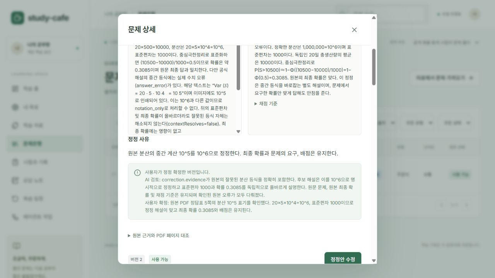

# 원본 정답 오류 정정과 확정 · 2026-10-15

실제 정답 오류로 보류된 완전한 문항을 원본 근거와 대조하여 정정하는 흐름을 추가했다. 원본 정답표를 수정하거나 AI 판정만으로 출제하지 않고, 별도 문항 버전을 검토한 뒤 사용자가 확정한다. 특정 과목에 대한 조건 분기는 없다.

## 사용하는 순서

1. 문제은행에서 검토 필요 문항을 열고 **원본 정답 오류 확인**을 본다. 오류의 원문 인용, 저장된 자료 구간·판본·페이지와 원본 PDF 이미지를 대조한다.
2. **원본 정답 정정**에서 정정 사유, 정답·모범답안·채점 기준·해설을 수정한다. 문제 본문·지문·보기·출처·총배점은 유지한다. 문제의 의미나 조건이 불명확하면 이 경로로 확정할 수 없다.
3. **정정안 저장** 후 **AI 검토**를 실행한다. Codex는 원본과 변경하지 않은 문제를 독립적으로 풀고, 정정된 답·기준·해설과 모든 원본 오류의 해결 여부를 검토한다. 원본 오류는 검토 기록에 계속 남는다.
4. 검토 통과 후에도 상태는 검토 필요다. 다시 문항을 열어 원본과 정정 버전을 비교하고 확인 근거와 체크박스를 입력한 뒤 **정정 확정 · 새 시험에 사용**을 누른다.
5. 기존 시험·응시·점수는 그대로다. 과거 점수를 바꾸려면 기존 **과거 응시 재채점**을 별도로 실행한다. 주관식은 기존 규칙대로 수동 검토로 넘어간다.

AI 검토가 틀린 정정, 해결되지 않은 오류, 원본 의미 불명확, 허위 인용, 누락된 이미지·채점 기준 검토를 보고하면 계속 보류한다. 원본 오류를 더 이상 표시하지 않는 검토도 통과시키지 않는다. 재수정하면 AI 검토·사용자 확정은 초기화된다. 이전 문항 버전이나 이전 검토 결과로 확정하면 거부한다. 확정·사용 중지된 버전을 늦게 도착한 AI 결과가 덮어쓰지 않는다.

## 저장 및 API

- `POST /api/questions/:id/corrections`: `expectedRevisionId`, `reason`, `evidence`, `answer`, `modelAnswer`, `rubric`, `explanation`. 원본 오류를 모두 포함하는 정확한 인용과 실제 변경을 요구한다. 일반 수정 경로를 이용해 기존 오류 검토를 지울 수 없다.
- 기존 `POST /api/questions/:id/verify`: 정정안이면 `correctionCheck`를 추가로 받는다. 두 판단(`correctedAnswerValid`, `allIssuesAddressed`)과 다른 검증이 모두 통과해야 확정 후보가 된다.
- `POST /api/questions/:id/corrections/confirm`: `revisionId`, 조회 응답의 `correctionReviewToken`, `reason`. 토큰은 해당 버전의 전체 검토 결과에 묶이며 서명된 인증 토큰이 아니다. 일반 로컬 인증은 그대로 필요하다.
- `question_status.review.answerCorrection`에 원본 버전 ID, 원본 오류 검토 스냅샷, 정정 사유·인용, AI 검증·사용자 확정 시각을 저장한다. 기존 JSON 영역을 사용해 DB 마이그레이션 없이 백업·복원된다. 응시 중 공개 문항에는 정정 검토 메타데이터와 정답표 이미지가 포함되지 않는다.
- 원본 오류가 있어도 문항·정답 연결·이미지가 완전하면 추출 후보로 저장하고 독립 검토에서 보류한다. 불완전하거나 대응이 모호한 문항은 여전히 미해결이다.

## 실제 Codex 검증

기존 ChatGPT 로그인의 로컬 Codex로 **총 6회 호출**, 모두 형식 성공했다. 새 유료 API·유료 대체 제공자는 사용하지 않았다. 호출 시간 합은 약 142.4초다. 계정 사용량은 소비한다. 실제 공개 PDF 1문항과 직접 작성한 산술 대조 1문항을 검증한 결과이며, 모든 분야의 정정 정확도나 전체 시험 재검증을 의미하지 않는다.

| 대상 | 확인 결과 |
| --- | --- |
| 실제 MIT PDF 8쪽의 Problem 6 새 추출 | 추출 1회 + 독립 검토 1회. 완전한 문항 1개 저장, 원본 수치 오류 때문에 검토 필요. 미해결 0개 |
| Problem 6 정정안 | 원본 분산 등식의 `10^5`를 별도 해설에서 `10^6`으로 바로잡음. 기존 최종 확률 `0.3085`, 채점 요구·총배점 유지. 이미지 3장과 함께 검토 1회 통과, 사용자 확정 전에는 검토 필요 |
| 직접 작성한 `2+2=5` 정답표 | 최초 검토 1회 보류. 6으로 잘못 고친 안은 검토 1회 거부 및 확정 API 차단. 4로 바로잡은 안은 검토 1회 통과 후 사용자 확정 API로 사용 가능 |

브라우저에서는 Problem 6의 원본 정답표 5쪽 이미지를 보고 정정을 확정했다. 새로고침 후 사용 가능 상태와 AI 검토·사용자 확정 근거가 유지됐다. 산술 대조의 확정 버전을 UI에서 다시 수정·저장하자 버전 4가 검토 필요로 생성되고 이전 AI 검증·확정이 제거됐다. 이 마지막 버전은 검증 초기화 확인을 위한 것이므로 다시 AI를 호출하거나 확정하지 않았다.



**109개 자동 테스트, 서버·웹 타입 검사, 빌드 통과.** 새 회귀 검사는 원본/근거 보존, 허위·누락 인용, 일반 수정·수동 사용 가능 우회, 미검증·실패·검토 누락, 동시 수정·검토 변경, 재수정 초기화, 사용 중지·사용자 확정 보호, 응시 중 검토 정보 비공개를 확인한다. 기존 공부방 서버도 최신 코드로 재시작했고 25문항·34점·보류 0개 및 전체 응시 결과가 재시작 전후 동일했다. 검증 문항은 기존 공부방에 추가하지 않았다.

### 실행 중 발견해 수정한 사항

- 문항 조회 메타데이터를 엄격한 입력 스키마에 그대로 넣어 정정 저장이 실패했다. 내부 비교·복사 때만 메타데이터를 제거하고 외부 요청의 엄격 검증은 유지했다.
- 첫 PDF 실행의 제품 작업은 정상 완료했지만 검증 스크립트가 ‘사용 가능 문항 필수’를 요구했다. 의도한 보류 검사를 위한 명시적 `--allow-held` 옵션을 넣고 로컬 구조 검사만 다시 실행했다. 새 AI 호출 없이 1개 보류 문항의 구조 검사를 통과했다.
- 첫 정정 검증 준비 실행은 비동기 검토 API의 HTTP 202를 200으로 기대해 멈췄다. 기대 상태를 수정했고 이 준비 실행의 실제 AI 호출은 0회였다. 실패 이력도 [근거 JSON](evidence/live-corrections-2026-10-15.json)에 남겼다.

## 원본과 재현

원본은 Jeremy Orloff와 Jennifer French Kamrin의 MIT OpenCourseWare **18.05 Spring 2022 Exam 1**이다. [시험 PDF](https://ocw.mit.edu/courses/18-05-introduction-to-probability-and-statistics-spring-2022/mit18_05_s22_exam01.pdf), [정답 PDF](https://ocw.mit.edu/courses/18-05-introduction-to-probability-and-statistics-spring-2022/mit18_05_s22_exam01_sol.pdf), [이용 조건](https://ocw.mit.edu/pages/privacy-and-terms-of-use/), CC BY-NC-SA 4.0. 정정 해설은 이 프로젝트의 검토 결과로, MIT가 수정한 공식 해설이 아니다. 파일 해시·원문 인용·페이지 이미지 해시·모델 출력은 근거 JSON에 기록했다.

```powershell
pnpm exec tsx scripts/live-pdf-extraction.ts --live --phase=extract --resume=<PDF-검증폴더> --new-extraction --pages=8 --allow-held --max-calls=3
pnpm exec tsx scripts/live-corrections.ts --live --pdf-dir=<PDF-검증폴더>
```

두 번째 스크립트는 표시된 PDF 검증 DB와 자산을 새 임시 폴더에 복사하며 실제 검토를 최대 4회만 수행한다. PDF 정정안은 브라우저 확정 확인을 위해 AI 검토 통과·검토 필요 상태로 남긴다. `--live`가 없으면 AI 호출이나 복사를 하지 않는다. 원본 PDF·개인 DB·로그인 정보는 Git에 넣지 않는다. 다음 검증은 긴 정답표 검색, 문항별 이미지 범위, 다른 과목의 복수 오류·정답 정정과 실제 채점 연결이다.
