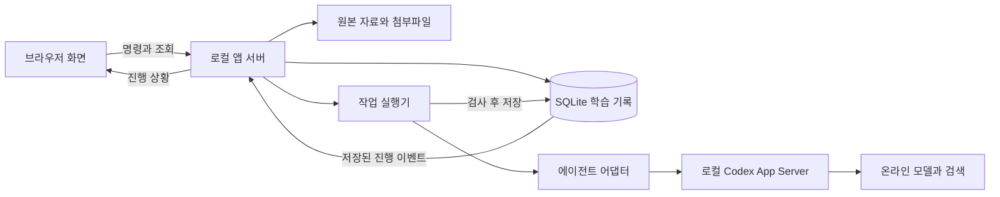

# study-cafe 프로젝트 설계

2026-10-13 · 설계 v0.1. 백엔드 구현의 현재 상태는 [검증 기록](VERIFICATION.md) 참고. 프론트엔드는 보류 중이다.

study-cafe는 사용자가 정한 목표를 기준으로 자료 조사, 20~30문항 시험, 채점, 개념별 오답 정리, 변형 복습을 이어가는 로컬 웹앱이다. 사용자 요구사항은 아래 표로 고정하고, 나머지 구현 방식은 이 설계의 제안으로 둔다. 기능의 구현·연동 완료를 뜻하지 않는다.

## 사용자 요구사항

| ID | 요구사항 | 설계 반영 |
|---|---|---|
| R01 | 프로젝트와 웹앱 이름은 study-cafe | 이름·저장소·문서에 동일하게 사용 |
| R02 | 내 PC에서 실행하는 로컬 웹앱 | 브라우저와 로컬 서버, 로컬 DB로 구성 |
| R03 | 로컬 코덱스를 로그인 방식으로 연결 | Codex App Server 어댑터를 기본 연동 후보로 채택 |
| R04 | 공부 주제는 범용 | 언어·프로그래밍·시험 목표를 공통 모델로 표현 |
| R05 | 먼저 목표 설정 | 막연한 입력을 구체화하고 목표별 학습 공간 생성 |
| R06 | 실제 시험처럼 회차당 20~30문항 | 20·25·30 선택, 제안 기본값 25 |
| R07 | 객관식·주관식 등 레이아웃을 미리 설정 | 재사용 가능한 시험 템플릿 |
| R08 | 목표에 맞는 인터넷 기출·자료를 폭넓게 조사 | 공식 범위 확인, 검색, 원문 확인, 수집 내역·부족 영역 표시 |
| R09 | AI도 문제 생성 | 기존 문제 우선, 부족 영역 생성, 출처 종류 표시 |
| R10 | 채점 후 오답을 따로 분류·요약 | 개념별 약점과 답안 근거, 설명·예시 저장 |
| R11 | 나중에 조금 변형해서 다시 풀기 | 원본·변형 관계 보존, 시차를 둔 재평가 |
| R12 | 다른 프로젝트의 로직·워크플로우 참고 | 원리를 선택해 재설계. 기존 앱 포크·코드 동일성은 요구하지 않음 |

## 이번 설계의 기본 선택

- 한 PC에서 쓰는 개인용, 한국어 UI와 Asia/Seoul 학습일 기준으로 시작한다. 언어·시간대는 설정값으로 둔다.
- 목표일·하루 공부 시간·현재 수준은 선택 입력이다. 모르면 공부를 시작한 뒤 보완한다.
- 기본 25문항, 일반 학습의 첫 템플릿 예시는 객관식 20 + 짧은 주관식 5다. 과목마다 변경할 수 있다.
- 일반 학습·약점 집중·오답 복습·실전 모의시험을 구분한다. 실전 모드는 확인한 해당 시험의 분량·유형·시간을 따른다.
- 기출만, 공식 문제 우선, 기존 문제와 AI 혼합, AI 생성만을 선택할 수 있게 한다. 혼합 모드를 기본 제안으로 둔다.
- URL·PDF·텍스트를 사용자가 직접 추가할 수 있게 한다. 자동 조사와 같은 자료 저장 구조로 합친다.
- 주관식의 부분 점수·채점 보류·사용자 재검토, 맞혔지만 헷갈린 표시, 답안 자동 저장을 포함한다.
- 애플리케이션 서버와 작업 실행기를 한 로컬 프로세스에서 운영하는 모듈 구조로 시작한다. 별도 서버 장비·Docker·클라우드 DB는 초기 필수 조건으로 두지 않는다.

## 목표와 화면

목표의 기본 구조는 `목표 → 영역 → 개념 → 문제와 학습 기록`이다. 목표는 관심사 학습, 시험 준비, 실제 수행 능력 향상으로 구분할 수 있다.

예를 들어 “일본어 공부”는 사용 목적을 물어 회화·독해·시험 중 방향을 정한다. “JLPT N2 합격”은 시험의 최신 공식 범위를 조사한다. “파이썬 자동화 코드 이해”는 코드 읽기·오류 찾기·수정하기 같은 수행 목표로 나눈다. 사용자가 예로 든 “AI-901 자격증 취득”도 시험 목표 입력으로 다룬다. 특정 자격시험의 현재 이름·범위·평가 방식은 조사 시점에 확인한다.

목표 범위는 버전으로 보존한다. 시험 범위가 바뀌어도 지난 시험·답안·점수가 새 범위에 조용히 섞이지 않는다. 개념이 다른 목표에도 등장하면 근거 기록을 연결할 수 있으나, 해당 목표의 성취를 자동으로 완료 처리하지 않는다.

| 화면 | 주요 내용과 행동 |
|---|---|
| 홈 | 내 목표, 이어 풀기, 오늘 복습, 진행 중인 작업 |
| 목표 만들기 | 자연어 입력 → 필요한 질문 → 목표 카드와 범위 초안 수정·저장 |
| 목표 개요 | 영역별 학습 상태, 자료 확보 상태, 다음 학습 제안 |
| 자료 조사 | 검색 범위·출처·진행 단계, 확보·중복·보류·링크 자료, 추가 조사 |
| 문제은행 | 영역·유형·출처·검증 상태 필터, 원문과 근거, 오류 신고 |
| 시험 만들기 | 템플릿, 문항 수, 출처 비율, 영역 비중, 난이도, 시간 |
| 시험 풀기 | 지문·그림·음성, 문항 목록, 답안, 헷갈림·나중에 보기, 저장 상태 |
| 결과와 오답 | 확정 점수와 보류 수, 개념별 약점, 근거와 해설, 채점 재검토 |
| 복습 | 예정 개념, 재풀이·변형 풀이 구분, 이전 결과와 변화 |
| 기록과 설정 | 회차 기록, 백업·복원, 에이전트 연결·사용 가능 상태 |

청해 목표는 처음부터 범위와 문항 묶음으로 표현한다. 음성 재생이 준비되지 않았으면 해당 영역을 “미지원”으로 표시하며, 전체 시험 대비가 가능하다고 표시하지 않는다. 초기 시험 화면은 데스크톱 우선으로 설계한다.

## 시스템 구조



“로컬 서버”는 사용자의 같은 PC에서 실행하는 프로그램이다. PC가 꺼지면 작업도 멈추며, 다시 실행할 때 저장된 단계부터 재개한다. 브라우저 탭만 닫으면 실행 중인 로컬 서버는 작업을 계속할 수 있다.

| 구성 | 제안 기술 | 선택 이유 |
|---|---|---|
| 화면 | React + TypeScript + Vite | 시험·자료·기록 화면을 공통 타입으로 구성 |
| 로컬 서버 | Node.js + TypeScript + Fastify | 로컬 프로세스 실행과 API·진행 이벤트 관리 |
| 원본 기록 | SQLite + SQL 마이그레이션 | 한 PC에서 관리하고 백업하기 쉬운 저장 단위 |
| 자료 파일 | 앱 데이터 디렉터리 + 해시 기반 파일 식별 | 원본·첨부 보존, 중복 파일 판별 |
| 초기 검색 | 개념·메타데이터 필터 + SQLite FTS5 후보 | 별도 검색 서버 없이 시작 |
| 에이전트 | 교체 가능한 Codex 어댑터 | 학습 규칙을 특정 공급자와 분리 |
| 진행 전달 | REST 명령 + SSE 이벤트 | 오래 걸리는 작업의 조회와 재연결 |
| 검증 | 런타임 스키마, 단위·통합·브라우저 테스트 | AI 결과와 저장 경계 검사 |

라이브러리 버전·SQLite 드라이버·복습 구현체는 P0에서 Windows 호환성을 확인해 고정한다. FTS5의 한국어·일본어 검색 품질도 실제 자료로 확인한다. 임베딩은 검색 실패가 확인될 때 검토하며, 코덱스 로그인으로 임베딩 서비스까지 사용할 수 있다고 가정하지 않는다. 관련 기술 문서는 [참고 자료](REFERENCES.md)에 연결한다.

제안 디렉터리 구조는 다음과 같다. 설계 단계에는 문서만 생성한다.

```text
apps/web/                 화면
apps/server/              API와 작업 실행기
packages/domain/          목표·시험·채점·복습 규칙
packages/contracts/       API와 AI 결과의 스키마
packages/agent-codex/      코덱스 연결 어댑터
packages/storage/         DB·파일 저장과 마이그레이션
packages/prompts/         역할별 프롬프트와 버전
tests/fixtures/           권한을 확인한 시험·자료 예제
docs/                     설계·워크플로우·개발 계획
```

실사용 DB·원문·답안·로그·백업은 Git 대상에서 제외한다. 기본 데이터 위치는 `%LOCALAPPDATA%\study-cafe`를 제안하며 사용자 변경을 허용한다. 백업은 SQLite의 일관된 스냅샷과 파일 목록·해시를 포함한다. 복원 시 스키마 버전을 확인하고 기존 데이터의 백업을 먼저 만든다.

## 에이전트 연결과 책임

초기 연결 후보는 로컬 `codex app-server`의 stdio 방식이다. 어댑터가 초기화, 계정 상태·지원 로그인, 스레드·작업 시작, 진행·종료·취소를 다룬다. 작업별 구조화 출력과 종료 상태를 검사하고, 설치된 Codex 버전에서 생성한 프로토콜 타입으로 호환성을 맞춘다. 로그인 가능과 실제 요청 성공은 별도로 확인한다. [공식 App Server 문서](https://learn.chatgpt.com/docs/app-server)

앱은 인증 토큰을 학습 DB·브라우저·로그로 복사하지 않는다. Codex가 관리하는 인증을 사용하는 범위를 P0에서 검증한다. 공유된 로그인에서 연결 해제는 앱의 프로세스·연결 종료로 처리하고 사용자의 전역 로그아웃과 구분한다. 별도 Sign in with ChatGPT 구현은 초기 기본 경로와 혼합하지 않는다. [인증 문서](https://learn.chatgpt.com/docs/auth)

에이전트의 역할은 작업 단계의 구분이다. 초기에는 하나의 연결에서 순차 실행하며, 여러 에이전트 프로세스를 항상 동시에 띄울 필요는 없다.

| 역할 | 입력 | 결과 |
|---|---|---|
| 목표 설계 | 목표 문장·사용자 답변 | 범위·영역·개념 초안, 부족한 정보 |
| 자료 조사 | 범위 버전·기존 출처·부족 영역 | 확인한 URL·자료 근거·수집 후보·미확인 범위 |
| 문항 작성 | 출제 슬롯·근거 구간·제약 | 문제·보기·정답 근거·해설·채점 기준 |
| 문항 검토 | 문제·근거·검사 규칙 | 독립 풀이와 정답 비교, 오류·애매함·검토 필요 |
| 답안 평가 | 고정 문제·루브릭·근거·사용자 답 | 기준별 점수·인용한 답안·보류 이유 |
| 학습 정리 | 확정 평가·개념 이력 | 약점 요약·설명·변형 학습 제안 |

앱은 문항 수·출처 정책·객관식 채점·타이머·저장·일정·중복 처리의 최종 책임을 가진다. AI는 검토 가능한 결과를 반환하고, 도메인 규칙을 통과한 결과만 DB에 반영한다. 설명 대화를 평가자에게 통째로 전달하지 않는다. 같은 모델을 역할별로 나눠 호출해도 오류의 독립성이 보장되지는 않는다.

초기에는 작업별 읽기 자료와 출력용 임시 폴더만 에이전트에 제공한다. 앱 DB·인증 저장소를 직접 편집하는 도구는 제공하지 않는다. 검색·파일 읽기 기능의 지원 여부와 권한은 연결 검사에서 확인한다. 일반 셸 실행이나 임의 외부 작업을 학습 작업의 기본 권한으로 주지 않는다.

## 자료 조사와 문제은행

목표별 연구 작업은 공식 시험 범위 → 공식 기출·예제 → 신뢰 가능한 외부 자료 → 사용자가 지정한 자료 순서로 탐색한다. 검색량·시간·호출 예산의 초기 제안은 작업당 30개 후보 URL 또는 10분 중 먼저 도달한 지점이다. 사용자가 계속 조사를 선택하면 기존 기록에서 확장한다. 예산 도달은 “조사 범위까지 완료”이며 인터넷 전체 조사 완료를 뜻하지 않는다.

출처의 URL, 제목, 게시자, 확인일, 시험·회차·범위 버전, 이용 조건 근거를 보존한다. 원문 수집 권한이 불명확하면 링크와 메타데이터만 남긴다. 코드 저장소의 공개 여부를 교재·시험 문제의 재사용 허가로 간주하지 않는다.

자료는 `발견 → 내용 확보 → 추출 → 검토 → 사용 가능`으로 진행한다. 차단·유료 접근·추출 오류·권한 불명확·정답 불명은 이유와 함께 보류한다. 웹 문서의 명령처럼 보이는 문장은 자료로 취급하고 앱·에이전트 지침으로 실행하지 않는다. 로컬 서버가 URL을 가져오는 경우 내부 주소·리다이렉트·파일 크기·시간 제한을 적용한다.

문제 출처는 `실제 기출 / 공식 예제 / 외부 연습 / AI 생성 / AI 변형`으로 구분한다. 실제 기출 표시는 시험·회차와 원출처 근거가 있을 때만 사용한다. AI가 실제 문제를 참고해 새로 만든 것은 AI 변형이다.

문제에는 영역·개념·유형·난이도, 정답 근거, 검토 결과를 붙인다. 본문·보기·정답·필수 지문·그림·음성이 모두 있어야 풀이 가능한 수에 포함한다. 지문/음성과 여러 문제는 하나의 자료 묶음으로 연결하되 화면에 표시하는 문항 수는 실제 답안 항목 수다.

중복은 본문·보기 정규화 해시로 1차 탐지하고, 근접 중복·원문 변형은 추가 검토한다. 동일 문제를 다른 출처에서 발견하면 출처를 추가한다. 보기 순서·숫자만 다른 문항은 독립 개념을 익힌 증거로 자동 계산하지 않는다.

검토 상태는 `draft / needs_review / usable / retired`로 둔다. `usable`은 현재 검사 기준을 통과했다는 뜻이며 무오류 보증은 아니다. 정답 근거 종류와 검사 방식·시점·프롬프트 버전을 함께 보존한다.

## 20~30문항 시험 구성

출제는 템플릿 → 구성표 → 기존 문제 선택 → 부족분 생성 → 전체 검사 → 시험지 고정 순서로 실행한다.

구성표는 각 슬롯의 영역·개념·문항 유형·난이도·출처 조건·배점을 기록한다. 예를 들어 25문항은 객관식 20 + 주관식 5로 먼저 배분하고, 영역 비중을 정수 문항 수로 나눠 합계가 정확히 25가 되도록 조정한다. 지문 묶음 때문에 제약을 동시에 만족할 수 없으면 충돌을 표시한다.

선정 우선순위는 출처 정책과 범위 충족 → 검토 통과 → 영역별 수량 → 학습 목적 → 최근 노출·문제 계열 중복 → 난이도다. 난수 시드와 제외 이유를 기록해 구성을 재현할 수 있게 한다. 독립적으로 출제하면 답이 드러나는 문제 계열은 같은 시험에서 제외하되, 본래 하나의 독해·청해 묶음은 유지한다.

생성은 3~5문항의 작은 묶음으로 수행하는 것을 초기 제안으로 둔다. 화면에는 최종 회차 총량 25와 생성 진행 수를 표시한다. 생성·검토 실패는 해당 슬롯만 제한적으로 재시도하고, 지정 총량과 유형을 충족하기 전에는 시험 준비 완료로 표시하지 않는다.

문항 검사는 구조·보기 ID·필수 첨부·유형별 정답 수, 범위·근거 일치, 독립 풀이와 정답 비교, 보기 애매함·답 노출, 근접 중복을 포함한다. 불확실하면 보류한다. 코딩·수학의 실행 검증은 별도 샌드박스가 준비된 단계에서만 추가하고, 실행하지 않은 검토와 구분한다.

기출만 25문항을 선택했는데 17문항이면 부족 8을 보여준다. 추가 조사·혼합 허용·회차 수량 변경 중 사용자가 선택해야 한다. 동의 없이 생성 문제로 채우거나 17문항을 25문항 완료로 표시하지 않는다. 복습 대상이 적으면 나머지를 약점·일반 학습으로 채우는 구성을 제안하고 비율을 표시한다. 복습 6개를 채우려고 의미가 같은 문제를 25개로 늘리지 않는다.

## 풀이와 채점

시험 시작 시 문항 버전·순서·보기 순서·배점·정답·채점 기준을 고정한다. 응시 API는 정답·해설·루브릭을 제출 전에 전달하지 않는다. 다만 개인용 로컬 앱이므로 PC 소유자에 대한 시험 보안 제품을 목표로 하지는 않는다.

답안은 서버가 확인한 저장 버전을 표시한다. 임시 브라우저 저장분은 재연결 시 답안 버전으로 합치고 충돌을 표시한다. 두 탭의 오래된 답안이 최신 답안을 덮어쓰지 않는다. 제출은 고유 요청 ID로 한 번만 처리하며 이후 답안 수정은 새 시도로 분리한다.

일반 학습은 일시정지·이어 풀기를 허용한다. 실전 모드는 서버의 종료 시각이 기준이며 탭 종료·새로고침으로 타이머가 멈추지 않는다. PC·서버가 꺼져도 재시작 시 저장된 종료 시각으로 만료 여부를 판단한다. 기한이 지나면 마지막으로 서버 저장이 확인된 답안을 제출 처리한다.

객관식은 보기 ID와 정답 집합으로 앱이 채점한다. 주관식은 출제 전에 작성한 채점 기준별 배점·부분 점수 기준과 답안을 비교한다. 미응답, 오답, 채점 대기, 오류로 인한 보류를 구분한다. 채점 보류를 0점이나 임의의 절반 점수로 확정하지 않는다.

결과에는 총 배점, 확정 채점 문항의 획득/가능 점수, 보류 문항 수를 따로 표시한다. 모든 점수가 확정된 뒤 총점을 확정한다. 실제 시험의 환산점수·합격 가능성은 확인한 환산 규칙이 없으면 계산하지 않는다.

오답 원인은 답안 근거가 있는 경우에만 분류한다. 개념 부족·조건 해석·적용 오류·계산/표기 실수·미응답·판정 불가를 구분하고, AI 추정과 사용자가 확인한 사유를 따로 저장한다. 사용자는 채점에 이의를 제기하고 수동 확정할 수 있다.

문제나 정답 수정은 새 버전을 만든다. 재채점은 기존 평가를 덮어쓰지 않고 대체 평가를 추가한다. 현재 성적과 복습 상태는 유효한 평가를 기준으로 다시 계산하며 같은 답안에 대한 재시도가 복습 횟수를 늘리지 않는다.

## 복습과 성취 상태

원본 문제, 각 변형 문제, 개념, 문제 계열을 연결한다. 정답을 외운 재풀이와 새 상황에서 해결한 결과를 분리하고 “헷갈림”은 정답이어도 복습 후보로 삼는다.

초기 복습 단위는 안정된 개별 문제/평가 항목이다. FSRS 계열 스케줄러는 어댑터로 두고 구현체·파라미터를 P0에서 고정한다. 새로운 변형 문항은 별도 항목으로 기록하며, 정답이라는 이유로 원본의 간격을 그대로 늘리지 않는다. 개념 상태는 관련 여러 항목의 근거를 모아 계산한다.

동일 세션의 즉시 재풀이, 힌트·해설을 본 답안, 사용자 요청으로 한 반복 연습은 기록하되 독립적인 회상 성공과 구분한다. 기본 정책은 같은 문제 계열의 하루 후속 풀이가 숙련 성공 수를 반복해서 올리지 않도록 하는 것이다. 스케줄에 반영한 이벤트와 제외 사유를 명시한다.

학업 점수와 회상 등급은 별도 값이다. 미응답·오답·필수 기준 미충족은 again 후보, 기준을 충족했지만 사용자가 어렵게 떠올렸다고 평가하면 hard 후보, 도움 없이 기준 충족은 good 후보로 둔다. easy는 사용자가 쉽다고 평가한 경우만 허용한다. 부분 점수를 받았다고 자동으로 hard로 변환하지 않는다. 사용자의 확신을 AI가 임의로 만들어내지 않으며, 변환 규칙은 버전으로 남긴다. 보류 평가는 일정을 확정 갱신하지 않는다.

화면 상태는 `아직 확인 안 함 / 학습 중 / 복습 필요 / 여러 번 확인됨`이다. 마지막 상태의 초기 제안 기준은 서로 다른 날에 확인한 성공 2회 이상과 새 변형 문제 성공 1회 이상이다. 이는 앱의 운영 규칙이며 숙달·합격 보증이 아니다. 이후 오답이 생기면 다시 복습 필요로 전환한다.

## 데이터 구조와 보존 규칙

| 엔터티 | 주요 필드와 관계 |
|---|---|
| Goal, ScopeVersion | 목표 문장·유형·수준·목표일·시간대, 범위 버전과 출처 |
| Concept, GoalConcept | 영역·개념·선수 관계, 목표별 비중·성취 투영 |
| Source, SourceRevision | URL·게시자·확인일·이용 조건, 원문 해시·파일·추출 버전 |
| SourceSegment, Asset | 페이지·문단·시간 범위·근거 문장, 지문·그림·음성 |
| QuestionFamily | 원문·변형·근접 중복 관계와 기준 개념 |
| Question, QuestionRevision | 문제 식별, 불변 본문·보기 ID·정답·해설·루브릭·유형·상태 |
| QuestionEvidence, QuestionConcept | 문항 버전과 근거 구간, 검토 결과와 개념 연결 |
| ExamTemplate, BlueprintSlot | 총수·유형별 수량·시간·모드·출처 정책, 슬롯별 제약 |
| Exam, ExamItem | 범위·템플릿 버전, 고정 문항 버전·보기 순서·배점 |
| Attempt, Answer | 시작·종료·제출 상태, 답안 버전·표시·확신·저장 시각 |
| Assessment, AssessmentCriterion | 평가자·규칙·버전·상태, 기준별 근거·점수·대체 관계 |
| ReviewItem, ReviewEvent, ReviewState | 문항과 복습 단위, 불변 평가 이력, 다음 일정과 알고리즘 버전 |
| Job, JobStep, JobEvent | 작업 입력 버전·상태·시도·임대·결과·진행 순번 |
| AgentRun | 공급자·스레드·턴 ID·모델·프롬프트 버전·관측된 사용량 |

모든 레코드는 안정된 ID를 쓰고 시각은 UTC로 저장한다. 날짜별 복습은 사용자 시간대에 맞춰 계산한다. 서로 다른 목표·개념 ID를 이름 문자열만으로 합치지 않는다. 부분 결과 저장과 작업 단계 완료를 같은 DB 트랜잭션으로 처리한다. 외부 파일은 임시 저장→해시 확인→원자적 이동→DB 연결 순서를 쓰고 미연결 파일을 복구 검사한다.

삭제는 우선 보관 처리한다. 이미 응시한 시험의 문항·출처 스냅샷은 참조 무결성을 유지한다. 개인 기록의 영구 삭제와 백업 삭제는 별도 사용자 행동으로 제공한다. 성적·성취는 원본 기록에서 재계산 가능한 조회 결과로 둔다.

## 작업 상태와 API 경계

공통 작업 상태는 `queued → running → succeeded`이며 중간에 `waiting_user`, `paused`, `failed`, `cancelled`가 될 수 있다. `waiting_user`는 출처 정책 변경·추가 정보 등 응답이 필요한 경우다. 사용자 중단과 연결 오류를 구분한다. 앱 재시작 시 임대가 만료된 작업을 검사하고 마지막으로 저장 완료된 단계 다음부터 재개한다.

네트워크 호출은 반복될 수 있지만 결과 반영은 입력 버전·단계 ID·슬롯 ID·요청 ID로 중복 제거한다. 호출 직후 PC가 꺼진 경우 모델 호출 비용까지 정확히 한 번이라고 보장하지 않는다. 오래된 작업의 늦은 응답은 세대 번호로 거부하고, 취소된 작업 결과가 DB에 확정되지 않게 한다. 초기 동시 실행은 AI 작업 1개를 기본값으로 둔다.

| 제안 API 그룹 | 책임 |
|---|---|
| `/api/goals`, `/api/goals/:id/scopes` | 목표와 범위 버전 |
| `/api/sources`, `/api/questions` | 자료 등록·문제 조회·검토·수정 버전 |
| `/api/goals/:id/research` | 조사 작업 시작, 즉시 job ID 반환 |
| `/api/exam-templates`, `/api/exams` | 구성표 생성·문항 준비·시험 고정 |
| `/api/attempts/:id/answers`, `/submit` | 버전 조건부 저장·중복 없는 제출 |
| `/api/assessments/:id/review` | 재검토·수동 확정·재채점 |
| `/api/goals/:id/reviews` | 복습 예정 조회·회차 구성 |
| `/api/jobs/:id`, `/events`, `/cancel`, `/resume` | 진행 조회·재연결·중단·재개 |
| `/api/agent/*`, `/api/backups/*` | 연결 상태와 백업·복원 |

경로는 애플리케이션 계약 초안이다. 긴 작업의 응답을 HTTP 연결 하나에 묶지 않는다. SSE 이벤트에는 job ID와 증가하는 sequence를 넣어 재접속 시 저장된 이벤트를 이어 받는다. 사용자에게는 작업 단계·확보 수·완료 수·문제와 다음 행동을 보여준다.

로컬 API는 loopback 바인딩, 허용 Host/Origin과 앱 세션 확인을 적용한다. 자료 HTML은 실행 가능한 콘텐츠로 렌더링하지 않는다. 로그에는 토큰·전체 개인 자료를 기본 기록하지 않고 필요할 때 사용자가 내보내는 진단 묶음을 제공한다.

## 초기 제품 범위와 확장

첫 통합 버전은 목표 생성, 실제 에이전트 연결, URL·텍스트 PDF 수집, 문제은행, 객관식·짧은 주관식 20~30문항, 저장·채점·오답·변형 복습, 작업 재개, 백업까지 포함한다. 단계별 구현 순서는 [구현 계획](IMPLEMENTATION_PLAN.md)을 따른다.

스캔 PDF OCR·복잡한 수식/표·청해 음성·코드 실행 채점·공식 형식 전체 모의시험은 확장 단계로 둔다. 지원하지 않는 자료와 영역은 누락 사실을 보여준다. 다중 사용자·학교 운영·결제·클라우드 동기화·SNS 공유는 초기 범위 밖이다.

첫 검증 목표는 파이썬 기초의 텍스트형 25문항 학습 순환이다. 일본어 자료로 언어·출처·지문 처리를 추가 검증하되 청해 지원 전에는 N2 전체 대비 완료로 표시하지 않는다. 샘플 자료는 실제 기출과 구분한다.
