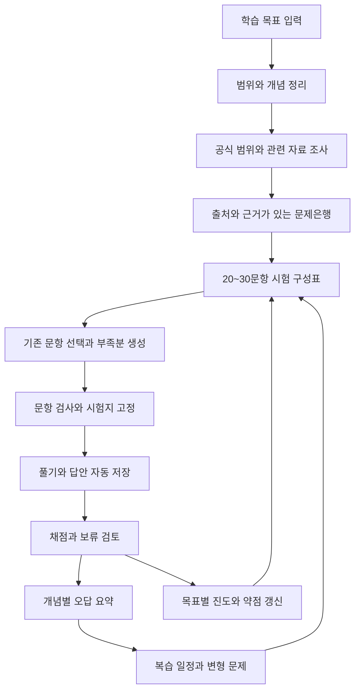
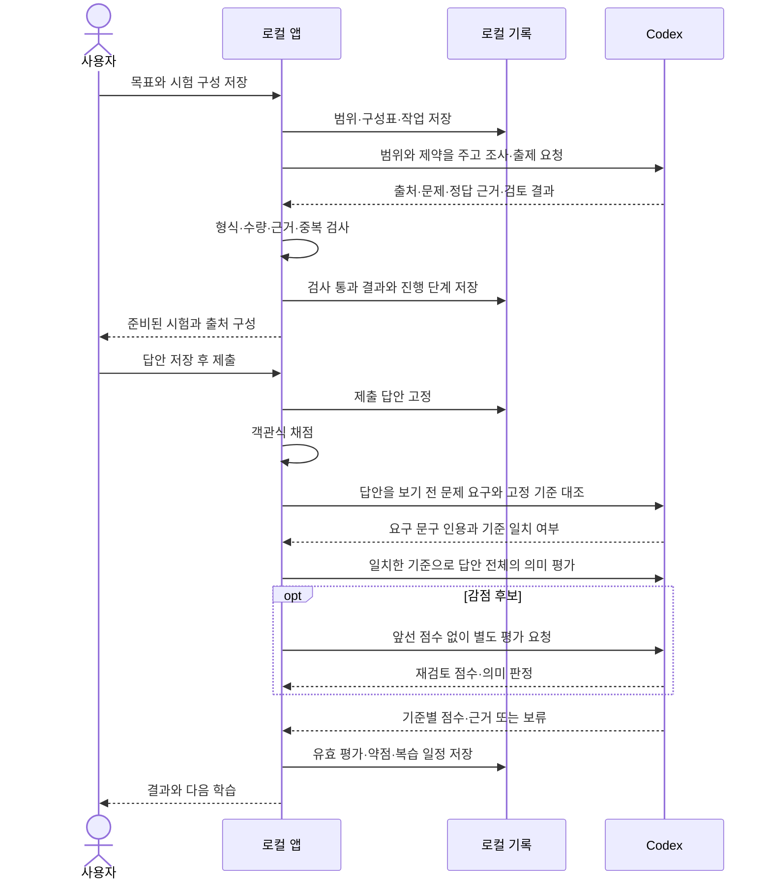

# study-cafe 워크플로우

2026-10-13 · 설계 v0.1 · 아래 화면·동작은 구현할 흐름이다.

## 전체 학습 흐름

목표를 만들 때 한 번 길게 설정하고 끝나는 방식이 아니다. 공부할 때마다 이전 자료·답안·약점을 사용하며, 홈은 오늘 할 일과 이어 풀기를 제안한다. 새 목표를 만들어도 같은 시험 템플릿을 재사용할 수 있다.

## 사용자가 처음 시작할 때

1. **목표를 적는다.** “파이썬 자동화 코드를 이해하고 수정하고 싶다”처럼 입력한다. “일본어 공부”처럼 넓으면 에이전트가 방향을 정하는 데 필요한 질문부터 한다.
2. **목표 카드를 확인한다.** 목표·범위·현재 수준·선택 일정·기본 시험 구성을 수정하고 저장한다. 시험 목표라면 공식 범위를 확인한 근거도 보여준다.
3. **자료 조사를 시작한다.** 출처·확인한 영역·수집 가능 여부·문제 확보 수가 쌓인다. 내가 가진 URL·PDF도 추가할 수 있다.
4. **시험을 만든다.** 기본 25문항, 예를 들어 객관식 20 + 주관식 5를 선택한다. 기출만·공식 우선·혼합·AI 생성 중 정책도 고른다.
5. **풀고 제출한다.** 문항 이동, 나중에 보기, 헷갈림 표시를 사용한다. 저장 성공 여부가 보이고 새로고침 후 이어 풀 수 있다.
6. **결과를 확인한다.** 확정 점수, 채점 보류, 개념별 약점, 정답 근거와 해설을 본다. 잘못된 판정은 재검토하거나 직접 확정한다.
7. **다음에 복습한다.** 예정된 문제와 새 변형 문제를 풀고, 같은 개념을 다른 상황에서도 해결했는지 기록한다.

## 자료 조사에서 시험 완성까지

다음 수치는 흐름을 설명하는 가상 예시다. 실제 자료 확보·정답 검증 결과를 뜻하지 않는다.

| 단계           | 사용자가 보는 내용                 | 내부 처리                                            |
| -------------- | ---------------------------------- | ---------------------------------------------------- |
| 조사 시작      | 조건문·반복문·함수 자료 조사 중    | 범위 버전, 조사 예산, 기존 출처를 입력으로 작업 생성 |
| 자료 검토      | 원문 확인·중복·보류·수집 불가 표시 | 원문 버전과 페이지/문단 근거 저장, 첨부 확인         |
| 시험 구성      | 총 25, 객관식 20 + 주관식 5        | 영역·유형·난이도·배점별 슬롯 25개 확정               |
| 기존 문제 선택 | 외부 연습문제 18개 사용            | 슬롯 조건·중복·이전 노출 확인                        |
| 부족분 작성    | AI 생성 7개 준비 중                | 혼합 정책에 따라 근거가 있는 슬롯만 생성·검토        |
| 준비 완료      | 외부 18 + AI 7, 총 25문항          | 유형 합계·자료 묶음·정답 근거 검사, 문항 버전 고정   |

기출만 선택했다면 AI 생성으로 채우지 않는다. 17개만 확보되면 “8개 부족”을 보여주고 추가 조사·혼합 허용·문항 수 변경을 선택하게 한다. 모든 후보 URL을 확인했다는 이유만으로 모든 학습 영역을 조사했다고 표시하지 않는다.

문항 생성은 내부적으로 작은 묶음으로 나눌 수 있다. 예를 들어 18/25에서 연결이 끊기면 확정된 18개는 유지하고 미완료 슬롯부터 재개한다. 아직 검토 중인 문항은 준비 완료 수에 포함하지 않는다.

선호 자료의 본문을 확보할 수 없으면 링크만 남기고 같은 범위의 독립적인 대안 자료를 조사한다. 사용 근거를 확인할 수 있는 대안이 없으면 미확보 범위를 보고하며 제한된 원문의 미러나 임의 본문으로 채우지 않는다. 실제 자동 대안 탐색과 URL 보충의 차이는 [자료 수집·출제 검증](LIVE_MATERIALS.md)에 기록했다.

문항의 형식·근거 문제는 제한된 횟수 안에서 보완할 수 있다. Codex 요청 제한·계정 한도·연결 오류는 내용 보완으로 해결되지 않으므로 원래 오류를 표시하고 중단한다. 상태가 회복된 뒤 같은 작업을 재개한다.

PDF 문항 추출은 한 구간씩 처리하고 인접 구간을 지문·이어서 나오는 문제의 문맥으로 읽는다. 한 응답에 최대 2문항을 받고 남은 문항을 이어받으며 각 완료 응답을 저장한다. 문제와 정답 자료의 앞뒤 구간도 판본 근거로 함께 전달한다. 문항은 현재 본문 구간에 인쇄된 번호를 기준으로 가져오며 정답의 인쇄 번호·같은 판본·원문 문구를 검사한다. 연결 정보의 인용은 서버에서 근거 목록에 합친 뒤 이번 요청의 원문과 대조한다. 글자 좌표는 원문 기록에 보존하고 텍스트 모델 입력에서는 제외한다. 그림·수식·정답 연결이 불완전하면 추측하지 않고 미해결로 남긴다. 실제 공개 시험 한 쌍의 결과와 한계는 [PDF 추출 검증](LIVE_PDF_EXTRACTION.md)에 기록한다.

## 앱과 에이전트가 나눠 하는 일

PDF 원본 페이지를 PNG로 렌더링해 텍스트와 함께 읽는다. 이미지에서 옮긴 문구·수식은 그 사실과 원본을 보존하고 별도 이미지 검토를 통과해야 한다. 정답은 같은 판본의 연속 구간 최대 5개까지 연결하고 문항 번호·상위 문제·내용을 대조한다. 문제 원본 이미지는 풀이 화면에서 볼 수 있지만 정답 이미지는 제출 전 문항에 포함하지 않는다. 필요한 페이지만 재추출할 수 있으며, 원본 오타·불명확한 그림은 보류한다. [이미지·다중 페이지 실제 검증](LIVE_PDF_VISUALS.md)을 참고한다.

코덱스는 조사·작성·분석을 담당한다. 앱은 문항 수, 저장, 객관식 정답 비교, 점수 합산, 제출 상태, 복습 일정의 규칙을 실행한다. 에이전트가 “25개 만들었다”고 말해도 앱에서 25개가 검사되지 않으면 완료가 아니다.

주관식은 먼저 제출 답안·모범답안을 제외하고 문제에서 실제로 요구한 내용과 출제 당시 기준을 대조한다. 기준이 요구하지 않은 설명까지 묶었다면 보류하며 기준이나 배점을 몰래 바꾸지 않는다. 일치한 기준으로 답안 전체의 의미를 평가하고, 감점 후보는 앞선 결과를 보여주지 않는 별도 평가와 비교한다. 두 평가가 다르거나 의미가 애매하면 보류한다. 모범답안의 표현과 같아야 할 필요는 없지만 명시한 설명·단위·순서 등은 충족해야 한다.

학습 중 사용자에게 설명해준 내용을 통째로 넣어 판정을 유도하지 않는다. 평가 요청이 실패하면 `보류`로 남기고 재개한다. 보통 주관식당 2회, 감점 후보는 3회 호출하므로 기존 Codex 한도와 처리 시간이 더 필요하다. 별도 유료 API 대체 경로는 없다.

요청 제한이 발생하면 작업에 사유를 표시하고 점수를 확정하지 않는다. 제한이 풀린 뒤 같은 작업을 재개하면 저장한 요구사항 검토·첫 평가를 다시 호출하지 않고 미완료 단계부터 진행한다. 실제 모델 사례와 한계는 [주관식 실제 검증](LIVE_GRADING.md)에 기록했다.

## 채점과 오답 정리 예시

가상 시험이 객관식 20개×1점과 주관식 5개×4점이면 총 40점이다. 객관식 16점, 주관식 12점으로 모두 확정되면 28/40점이다. 주관식 2개가 보류라면 확정 부분의 획득/가능 점수와 보류 2개를 표시하고 최종 총점은 대기시킨다.

오답 카드에는 아래 내용을 연결한다.

- **개념:** 반복문 종료 조건
- **내 답과 판정 근거:** 어떤 부분이 기준을 충족하지 못했는지
- **원인:** 조건 해석 오류 등 근거가 있는 분류, AI 추정 여부
- **다시 볼 설명:** 짧은 개념 정리와 반례
- **다음 문제:** 같은 개념을 다른 코드·수치·상황에서 확인하는 변형
- **이력:** 원본 재풀이인지, 처음 본 변형인지, 힌트를 봤는지

변형 문제를 통과한 기록은 개념 상태에 반영한다. 원본 문제의 복습 간격을 그대로 늘리는 것과는 별개다. 재채점은 기존 답안에 대한 판정 수정으로 처리하고 새 복습 성공 횟수를 만들지 않는다.

## 다음 공부를 시작할 때

홈에서 `이어 풀기 → 예정된 복습 → 약점·미학습 영역`을 제안한다. 사용자는 순서를 바꾸거나 새 시험을 만들 수 있다.

예정된 복습이 6문항이라면 “복습 6 + 약점 연습 9 + 새 영역 10 = 25” 같은 혼합 구성을 제안한다. 추가 19개가 복습인 것처럼 표시하지 않는다. 복습만 선택한 경우 실제 확보 수를 보여주고 사용자가 짧은 회차를 선택할 수 있다.

일정은 개별 복습 항목의 기록으로 계산한다. 성취 상태는 여러 날의 성공·새 변형 풀이·최근 오답을 함께 본다. 단순 문제 풀이 개수나 한 번의 정답률을 목표 달성으로 바꾸지 않는다.

## 중단·오류·부족 상황

| 상황                               | 처리                                                           |
| ---------------------------------- | -------------------------------------------------------------- |
| 로그인은 됐지만 호출 불가          | 연결 상태와 실제 요청 실패를 구분하고 기존 기록 열람·풀이 허용 |
| 기출·필수 지문·음성이 부족         | 부족 영역·필수 자산을 표시, 해당 문항은 준비 완료에서 제외     |
| 자료를 수집할 수 없음              | 링크와 사유 보존, 다른 출처 또는 사용자 자료 제안              |
| 생성 결과 형식 오류·정답 불확실    | 해당 슬롯 재시도 또는 보류, 빈 자리를 성공 처리하지 않음       |
| 네트워크 단절·앱 재시작            | 확정된 결과부터 복구, 미완료 단계 재개, 중복 반영 방지         |
| 같은 답안이 두 탭에서 수정됨       | 버전 충돌 표시, 오래된 값의 자동 덮어쓰기 방지                 |
| 실전 모드 시간이 PC 종료 중 만료됨 | 재실행 시 만료 처리, 마지막으로 서버 저장된 답안 사용          |
| 주관식 평가 실패·판정 애매함       | 보류, 재평가 또는 사용자 확정 후 성적·복습 갱신                |
| 문제·정답 오류 발견                | 새 문항 버전, 영향받은 평가 재검토, 이전 근거 보존             |
| 사용자가 작업 취소                 | 완료 결과 보존, 미완료 단계 중단, 늦게 온 응답 반영 차단       |

## 개발할 때의 작업 흐름

요구사항 ID와 완료 조건 선택 → 도메인·입출력 계약 작성 → 저장·화면·에이전트 연결 구현 → 해당 실패 사례 검증 → 실제 사용자 흐름 확인 → 문서 갱신 순서로 진행한다.

개발 기준 브랜치는 `develop`이다. 기능 단위 브랜치를 사용한다면 여기서 시작해 검증 후 합치는 방식을 제안한다. 설계 문서 작성만으로 커밋·푸시·배포를 자동 실행하지 않는다. 상세 단계와 완료 조건은 [구현 계획](IMPLEMENTATION_PLAN.md)에 있다.
